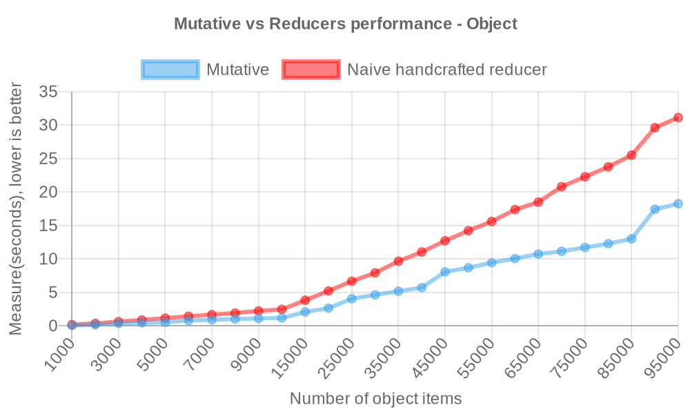
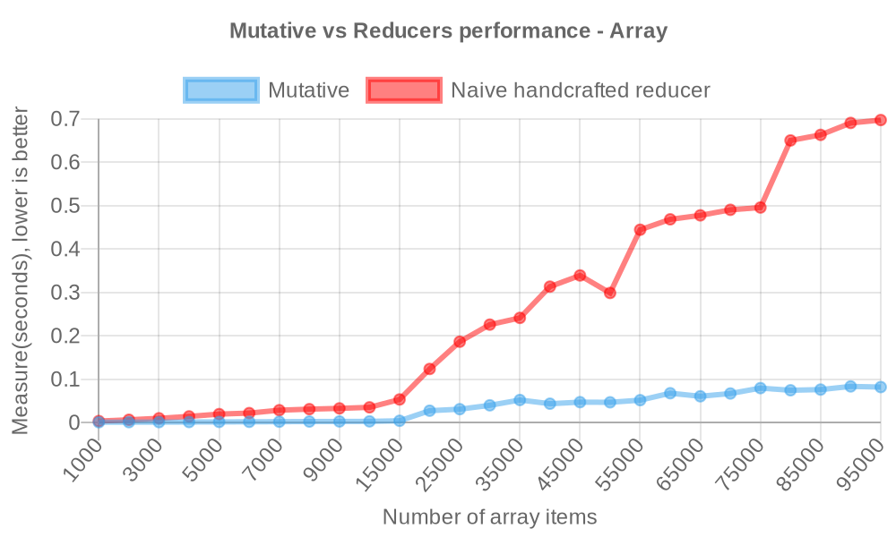
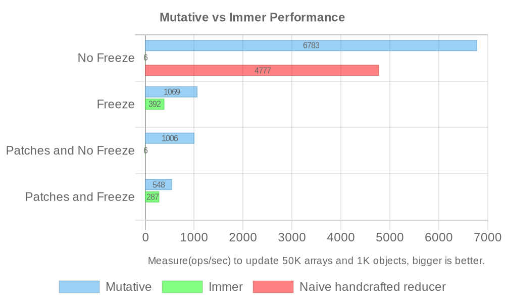

<Callout type="info">
本文于 2023 年 12 月介绍 Mutative 1.0，包含当时的基准测试与脚本，仓库后来已将它们替换。当前数据请查看[性能文档](/zh/docs/getting-started/performance)。
</Callout>

在 JavaScript 开发中，高效管理不可变状态是高性能应用的基础。今天我们发布 Mutative 1.0，探索更高效的不可变更新方式。在当时的测试中，其性能为朴素手写 reducer 的 2–6 倍、Immer 的 10 倍以上，为不可变状态管理提供了新的选择。

仓库：[Mutative](https://github.com/unadlib/mutative)

## 主要功能与优势 [#key-features-and-benefits]

Mutative 提供了一组兼顾性能与灵活性的功能：

- **高性能**：以速度为核心，尤其适合大型数据结构和复杂应用。
- **易用的不可变更新**：支持对象、数组、Set、Map 和可自定义类型，使不可变更新既高效又易于编写。
- **灵活配置**：可选的数据冻结、严格模式和 JSON Patch 支持，可按应用需要调整。

## 性能 [#performance]

### 对象 reducer [#reducer-by-object]

- 朴素手写 reducer

```ts
// baseState type: Record<string, { value: number }>
const state = {
  ...baseState,
  key0: {
    ...baseState.key0,
    value: i,
  },
};
```

- Mutative

```ts
const state = create(baseState, (draft) => {
  draft.key0.value = i;
});
```



> 更新含 1 千至 10 万项的对象，单位为秒，越低越好（[源码](https://github.com/unadlib/mutative/blob/e6b6563b821305b8ee0d63c42a62cea752cc04f0/test/performance/benchmark-object.ts)）。

**在该不可变对象更新测试中，Mutative 的性能最高约为朴素手写 reducer 的 `2` 倍。**

### 数组 reducer [#reducer-by-array]

- 朴素手写 reducer

```ts
// baseState type: { value: number }[]

// slower 6x than Mutative
const state = [
  { ...baseState[0], value: i },
  ...baseState.slice(1, baseState.length),
];

// slower 2.5x than Mutative
// const state = baseState.map((item, index) =>
//   index === 0 ? { ...item, value: i } : item
// );

// same performance as Mutative
// const state = [...baseState];
// state[0] = { ...baseState[0], value: i };
```

> 实际差异取决于使用的展开语法写法。

- Mutative

```ts
const state = create(baseState, (draft) => {
  draft[0].value = i;
});
```



> 更新含 1 千至 10 万项的数组，单位为秒，越低越好（[源码](https://github.com/unadlib/mutative/blob/e6b6563b821305b8ee0d63c42a62cea752cc04f0/test/performance/benchmark-array.ts)）。

**在该不可变数组更新测试中，Mutative 的性能最高约为朴素手写 reducer 的 `6` 倍。**

## Mutative 与 Immer 的性能 [#mutative-vs-immer-performance]

> Mutative 通过了 Immer 的全部测试用例。

更新 5 万项数组和 1 千项对象，单位为每秒操作数，越高越好（[源码](https://github.com/unadlib/mutative/blob/e6b6563b821305b8ee0d63c42a62cea752cc04f0/test/performance/benchmark.ts)）。此处比较 Mutative v1.3.0 与 Immer v10.1.3。



```
Naive handcrafted reducer - No Freeze x 4,777 ops/sec ±1.06% (94 runs sampled)
Mutative - No Freeze x 6,783 ops/sec ±0.71% (96 runs sampled)
Immer - No Freeze x 5.72 ops/sec ±0.39% (19 runs sampled)

Mutative - Freeze x 1,069 ops/sec ±0.75% (97 runs sampled)
Immer - Freeze x 392 ops/sec ±0.66% (92 runs sampled)

Mutative - Patches and No Freeze x 1,006 ops/sec ±1.73% (95 runs sampled)
Immer - Patches and No Freeze x 5.73 ops/sec ±0.16% (19 runs sampled)

Mutative - Patches and Freeze x 548 ops/sec ±1.06% (94 runs sampled)
Immer - Patches and Freeze x 287 ops/sec ±0.84% (93 runs sampled)

The fastest method is Mutative - No Freeze
```

当时可运行 `yarn benchmark` 测量性能。

> 系统：macOS 14.7，CPU：Apple M1 Max，Node.js：v22.11.0。

在这些历史测试中，Immer 的表现依赖自动冻结；关闭自动冻结后性能显著下降，Mutative 在大型结构上的优势可超过 50 倍。

因此，在这些测试条件下，Immer 需要开启自动冻结以取得更好的性能，而 Mutative 默认关闭。各自默认配置的结果为 Mutative `6,783 ops/sec`、Immer `392 ops/sec`，相差约 17 倍。

在当时的[其他性能测试场景](https://github.com/unadlib/mutative/tree/e6b6563b821305b8ee0d63c42a62cea752cc04f0/test/performance)中，Mutative 也展现了较大的性能优势。

## 与 Immer 对比 [#comparison-with-immer]

Immer 已被广泛用于不可变数据处理。Mutative 1.0 在通过其全部测试用例的基础上，提供自定义浅拷贝、严格模式、默认不冻结等功能；在当时的测试中，性能超过 Immer 的 10 倍，尤其面向大型应用。以下为当时的功能对比：

| 功能 | Mutative | Immer |
| :--- | ---: | :---: |
| 自定义浅拷贝 | ✅ | ❌ |
| 严格模式 | ✅ | ❌ |
| 默认不冻结数据 | ✅ | ❌ |
| 非侵入式标记 | ✅ | ❌ |
| 完整冻结数据 | ✅ | ❌ |
| 非全局配置 | ✅ | ❌ |
| 异步草稿更新函数 | ✅ | ❌ |
| 兼容 JSON Patch 规范 | ✅ | ❌ |
| 新 Set 方法（Mutative v1.1.0+） | ✅ | ❌ |

Mutative 还处理了意外草稿泄漏等 Immer 的边界问题，见[差异测试](https://github.com/unadlib/mutative/blob/main/test/immer-non-support.test.ts)。

## 快速入门 [#getting-started]

可通过 Yarn 或 npm 将 Mutative 加入 JavaScript 项目，API 简单直观：

1. 安装 Mutative：

```bash
yarn add mutative
```

2. 导入 `create`，生成新的不可变状态：

```javascript
import { create } from 'mutative';

const baseState = {
  foo: 'bar',
  list: [{ text: 'coding' }],
};

const state = create(baseState, (draft) => {
  draft.list.push({ text: 'learning' });
});

expect(state).not.toBe(baseState);
expect(state.list).not.toBe(baseState.list);
```

这个示例展示了如何用 Mutative 简洁地管理不可变状态。

## 结语 [#conclusion]

Mutative 1.0 的发布，希望让 JavaScript 开发者能以更简单的方式管理状态，结合现代 JavaScript 的能力，在速度、效率和易用性之间取得更好的平衡。

通过改进不可变更新的实现，Mutative 希望减少繁琐的状态处理，让开发者更容易构建快速、响应及时的应用。

随着 JavaScript 生态持续发展，我们也期待社区探索它的潜力，将它集成到项目，并参与改进。欢迎一起推进不可变状态管理，让应用更快，也更易开发。

欢迎使用 Mutative 1.0，探索高效不可变更新。
