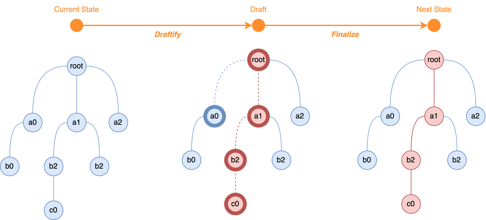

Mutative is based on `Proxy`. A recipe changes a draft of the state, Mutative records which parts changed, and it produces the next state from those changes, sharing every part that did not change. Patches describe the changes, and marks decide which values are drafted.

## Base Workflow



- The current state is the base state, which never changes.
- The draft is where the recipe makes its changes. Mutative creates a draft of each object that the recipe reads, shown with dotted lines, and copies the objects that it changes, shown in red.
- The next state holds the copies of the changed objects and shares all the others with the base state.

```ts
import { create, isDraft } from 'mutative';

const baseState = {
  a0: {
    b0: {},
  },
  a1: {
    b1: {},
    b2: {
      c0: 0,
    },
  },
  a2: {},
};

const nextState = create(baseState, (draft) => {
  const { a0 } = draft;
  // Reading a draftable value through a draft gives a draft of it.
  expect(isDraft(a0)).toBe(true);
  draft.a1.b2.c0 = 1;
});

expect(nextState).not.toBe(baseState);
// Drafted but not changed: shared with the base state.
expect(nextState.a0).toBe(baseState.a0);
// Never read: shared with the base state.
expect(nextState.a2).toBe(baseState.a2);
// Changed, and every object on the path to the change: copied.
expect(nextState.a1).not.toBe(baseState.a1);
expect(nextState.a1.b2).not.toBe(baseState.a1.b2);
expect(nextState.a1.b1).toBe(baseState.a1.b1);
expect(nextState.a1.b2.c0).toBe(1);
```

## Drafts

A draft is a `Proxy` of a value of the state. It behaves like that value: a recipe reads it, assigns to it, deletes from it and calls its methods, such as `push()` on arrays or `set()` on Maps. Mutative drafts lazily:

- Reading a draftable value through a draft gives a draft of it, created on that first read. Plain objects, arrays, Maps and Sets are draftable, and so are the values that a [mark](/docs/advanced-guides/mark) makes draftable, such as class instances; see [`isDraftable()`](/docs/api-reference/isdraftable). Other values, such as primitives and dates, are returned as they are.
- The first change to a draft makes a shallow copy of its value, and later changes go to the same copy, so Mutative copies each object at most once per update, however many changes the recipe makes.
- Values that the recipe assigns are not drafted: the next state holds them as they are.
- Each path to an object gets a draft of its own, also when several paths lead to the same object; see [Shared references](/docs/extra-topics/shared-references).

Drafts live only as long as their `create()` call: when the recipe ends, Mutative revokes them, and reading one later throws. Keep [`current(draft)`](/docs/api-reference/current), a snapshot of plain values, instead of a draft, and check for drafts with [`isDraft()`](/docs/api-reference/isdraft).

## Finalization

When the recipe ends, Mutative finalizes the drafts: the next state holds the copy of each changed draft and the original value of every unchanged one, so it shares every object that the recipe did not change with the base state. A recipe that changes nothing returns the base state itself. With [auto-freeze](/docs/advanced-guides/auto-freeze), Mutative then freezes the next state deeply.

A recipe can also return a new state instead of changing the draft; see [Returning a new state](/docs/api-reference/create#returning-a-new-state).

## Patches

With the `enablePatches` option, `create()` also returns patches, which describe the changes of the recipe, and inverse patches, which undo them. Each patch is an object with an `op`, `add`, `remove` or `replace`, a `path` from the root to the changed value, and, for `add` and `replace`, the new `value`. [`apply()`](/docs/api-reference/apply) applies patches to a state, for example to replay changes on another copy of the state or to undo them; see [Patches](/docs/advanced-guides/patches).

## Mark

A state can mix data that should be drafted with data that should not, such as class instances, caches or values from other libraries. The `mark` option decides, value by value, whether Mutative drafts a value, leaves it mutable, or copies it with a function of your own, without marking the objects themselves. See [Marking data structure](/docs/advanced-guides/mark).
